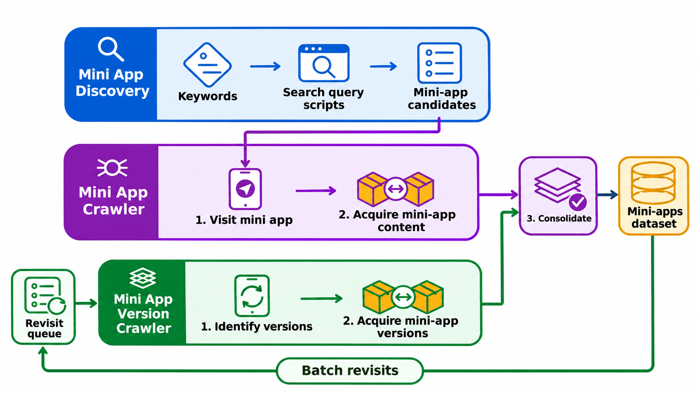

# MiniZoo Scraper

Collect WeChat Mini Programs and their metadata on a rooted Android phone.
Save everything locally in `collection_results/`.

Developed and tested with **WeChat 8.0.72 for Android**.

# Publication

More details about this work can be found in the paper [MiniZoo: An Evolving Dataset of Mini Apps for the Research Community](https://arxiv.org/abs/2611.13125):

```
@misc{ferrari2026minizooevolvingdatasetmini,
      title={MiniZoo: An Evolving Dataset of Mini Apps for the Research Community}, 
      author={Luca Ferrari and Marco Alecci and Jordan Samhi and Tegawendé F. Bissyandé and Jacques Klein and Luca Verderame},
      year={2026},
      eprint={2611.13125},
      archivePrefix={arXiv},
      primaryClass={cs.SE},
      url={https://arxiv.org/abs/2611.13125}, 
}
```
---

## 1. Install

On **macOS or Linux**, install [Git](https://git-scm.com/downloads) and
[Docker with Compose](https://docs.docker.com/get-started/get-docker/), then start Docker.
Open a terminal and run:

```sh
git clone https://github.com/Mobile-IoT-Security-Lab/MiniZoo-Scraper.git
cd MiniZoo-Scraper
docker compose build collection
```

The first build downloads the software dependencies. Python and Node.js are
included in Docker. When the build finishes, connect your phone below.

## 2. Connect your phone

For real collection you need an **already rooted Android phone**, USB debugging,
WeChat logged in, and Frida Server **17.18.0** running on the phone.

Follow the [phone setup](docs/DOCKER.md#connect-phones) once. It shows how to
connect USB, check Frida and select your phone. Keep the phone unlocked with
WeChat open, and continue in the same terminal.

## 3. Choose what to do

Open one guide and follow its numbered steps. Each starts with a single query
or app so you can inspect the result before collecting more.

| I want to… | Input I need | Follow this guide |
| --- | --- | --- |
| **Collect a mini app** | A CSV containing its name. | [Collect your first app](scraper/README.md#quick-start-with-docker) |
| Find mini apps by keyword | A text file containing search terms. | [Discover apps](discovery/README.md#quick-start-with-docker) |
| Check known apps for newer versions | A CSV containing AppID, name and previous version. | [Collect versions](version_scraper/README.md#quick-start-with-docker) |

Each module runs independently. Start with **Collect your first app** if you
already know the app's name. For simultaneous collection, use one phone per role.

## Where are my results?

| Folder | Contents |
| --- | --- |
| `collection_results/initial/` | Collected packages, metadata and per-app outcomes. |
| `collection_results/discovery/` | Discovered AppIDs, catalogue and search progress. |
| `collection_results/version/` | Version history, packages and checkpoints. |
| `private/` | Your input files and settings. |

A missing category can be filled as **Mini game** when a saved WeChat search
result explicitly identifies the same AppID as a game. Specific service
categories take precedence; see the [metadata guide](scraper/README_package_metadata.md#identifying-the-app-that-opened).

These folders are excluded from Git. Press **Ctrl-C once** and wait for the
collector to save its progress before disconnecting a phone.

Generic network messages such as “try again later” do not count as rate limits.
Explicit request limits and account verification still pause collection; failed
searches are not counted as empty results.


Before moving to the next app, the collectors handle the native **Authorize Data:
WeChat Login** dialog with one attempt: select **I have read** only if it is
unchecked, then press **Confirm**. If that fails or the dialog returns, preserve
the available packages and close the mini app to continue. This accepts the
WeChat login data authorization shown by that specific dialog. Other consent
screens are not accepted automatically; account verification and explicit rate
limits remain blocking. Saved cache bytes do not certify a successful acquisition.

If that exact dialog is still loading or its **Confirm** button is temporarily
obscured, the collectors wait for fresh observations before acting.
Late package downloads receive a bounded cache-preservation retry. Unknown
screens, changed package bytes and unresolved dialogs still stop the affected
collector with its evidence saved.

## Other tasks

- [Inspect or reconstruct saved packages](MiniZooCollectionCore/README.md).
- [Troubleshoot Docker or use Linux USB](docs/DOCKER.md).
- [Install without Docker](docs/NATIVE.md).
- [Optional batch collection](scraper/automation/README.md).



Project code: [MIT license](LICENSE). Dependencies and collected packages retain
their own licenses; see [provenance](docs/PROVENANCE.md). Cite with [CITATION.cff](CITATION.cff).
